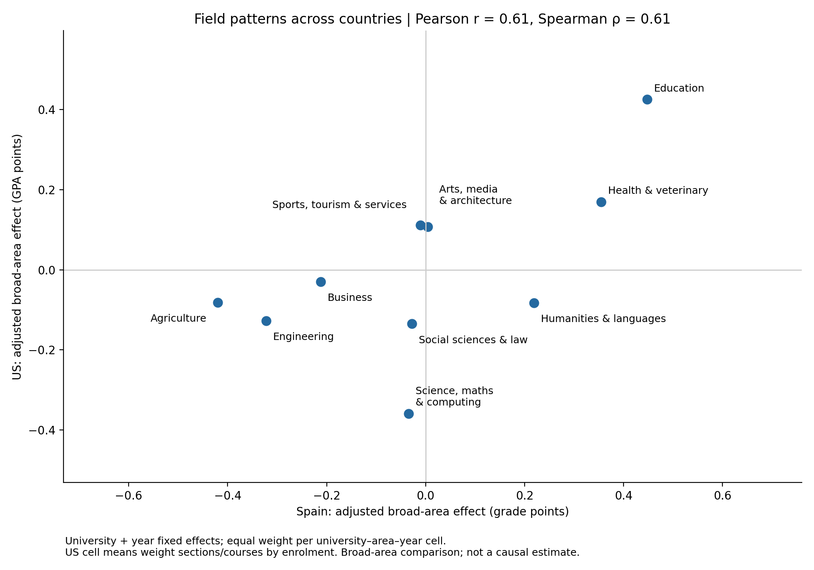

# US replication: findings

## Answer

The Spanish pattern **partly replicates** in the US data at the broad-area level.
Across ten matched areas, Pearson's correlation of adjusted field effects is
**0.613** and Spearman's rank correlation is **0.612**.
Eight areas have effects with the same sign. This does not establish a
29-field replication or a causal effect of grading policy.

Education and health/veterinary have positive adjusted effects in both
countries. Engineering, agriculture and business have negative effects in both.
Science/mathematics/computing is below average in both but much further below
in the US. Humanities/languages is positive in Spain and negative in the US.
Sports/tourism/services changes sign, although its Spanish effect is near zero.

| Broad area | Spain effect | US effect |
|---|---:|---:|
| Agriculture | -0.420 | -0.081 |
| Arts, media & architecture | +0.004 | +0.108 |
| Business | -0.212 | -0.029 |
| Education | +0.448 | +0.425 |
| Engineering | -0.322 | -0.128 |
| Health & veterinary | +0.355 | +0.170 |
| Humanities & languages | +0.219 | -0.082 |
| Science, mathematics & computing | -0.034 | -0.359 |
| Social sciences & law | -0.027 | -0.135 |
| Sports, tourism & services | -0.010 | +0.112 |

Effects are in each country's original grade-point units and sum to zero across
areas. Their magnitudes are not directly comparable across grading scales.
Their correlation is unaffected by a positive linear rescaling of either scale.

## Sample and method

The supplied archive contains **1,449,779 rows across 33 CSVs**. After
removing 19,603 exact duplicates and applying GPA, mapping and enrolment checks,
**1,198,266 course/section observations** enter the weighted analysis.
These form **1,845 university–area–year cells across 29 US institutions**
(2009–2023). The crosswalk covers **94.0%** of rows with
valid GPA and year. Exclusion flags overlap; inspect `us_data_audit.csv` rather
than adding its exclusion columns.

Georgia Tech, Parkland College, Purdue and UNC Charlotte have no enrolment
counts. They are loaded and audited but excluded from enrolment-weighted
estimation. The equal-section-weight sensitivity includes all 33 institutions.
UC Irvine lacks department codes in its grade CSV; its names are matched to
unique names in that institution's source mapping workbook.

GPA is reconstructed from numeric letter-grade percentages, excluding pass/fail
outcomes and withdrawals. Following Jeong et al., A+ is 4.3. Within each US
university–area–year cell, section/course GPAs are weighted by total enrolment.
Spanish detailed-field means are averaged equally within each broad-area cell.
The Spanish comparison uses **5,691 cells from 89 universities**
(2015–2023), following the original Ministry sample.

Both country regressions use `mean ~ C(field, Sum) + C(univ) + C(year)` on the
same ten broad areas, with equal regression weight per cell. The code uses
NumPy/SciPy to implement the same OLS design as `ministry.py`, including
conventional standard errors. Re-estimating all 29 original Spanish fields
reproduced the repository's saved coefficients and SEs to three decimals.
Six numerical tests cover grade calculation, enrolment weighting, mapping,
missing department codes, regression contrasts and unidentified designs.

## Sensitivity

| Specification | Pearson r | Spearman rho | US institutions |
|---|---:|---:|---:|
| Main enrolment-weighted cells | 0.613 | 0.612 | 29 |
| equal_section_weights_all33 | 0.624 | 0.624 | 33 |
| a_plus_capped_at4 | 0.613 | 0.697 | 29 |
| common_years | 0.629 | 0.661 | 28 |

Common years are 2015–2023. Leaving out each US university in turn gives Pearson
correlations from **0.604 to
0.631**. These checks support the
broad positive association, while the ordering of closely ranked areas can change.

## Limits and review points

- These are ten broad areas chosen to make the systems comparable. The editable
  department crosswalk is rule-generated from the authors' institution-specific
  workbook and should receive subject-matter review, especially mixed departments
  and services. We have not manually certified every department assignment.
- US course/section grades include different course levels; the data do not provide
  a uniform undergraduate flag. Spanish outcomes are graduates' final grades.
  Student selection, course level and within-area composition are uncontrolled.
- The Spanish sample includes the universities in the original analysis; it has not
  been restricted to public institutions. Four US institutions lack weights.
- Missing numeric-grade categories are treated as zero. Reported grade percentages
  can be inconsistent, and invalid rows are excluded. Exact duplicates are removed;
  cross-listed or otherwise overlapping records are not inferred or deduplicated.
- Correlations use only ten area estimates. No causal claim, formal cross-country
  equivalence test or detailed-field replication is warranted. Standard errors
  match ordinary OLS in the original project and are not clustered by university.

## Reproduce and source

Run `python src/us_replication.py` after downloading the data as explained in
README. Raw files and intermediate tables are ignored by Git. Input and crosswalk
SHA-256 checksums are in `results/us_replication_stats.json`.

Source: Jeong, H., Weiss, G. M., Leung, A., & Leeds, D. D. (2024).
*The Construction and Analysis of Course Grades Across Public Universities.*
[EDM paper](https://www.educationaldatamining.org/edm2024/proceedings/2024.EDM-posters.67/)
and [Kaggle dataset](https://www.kaggle.com/datasets/hyunjeong2023/edm-grading-dataset).

Validation environment: numpy 2.3.5, pandas 2.2.3, scipy 1.17.0, matplotlib 3.10.8, openpyxl 3.1.5.
